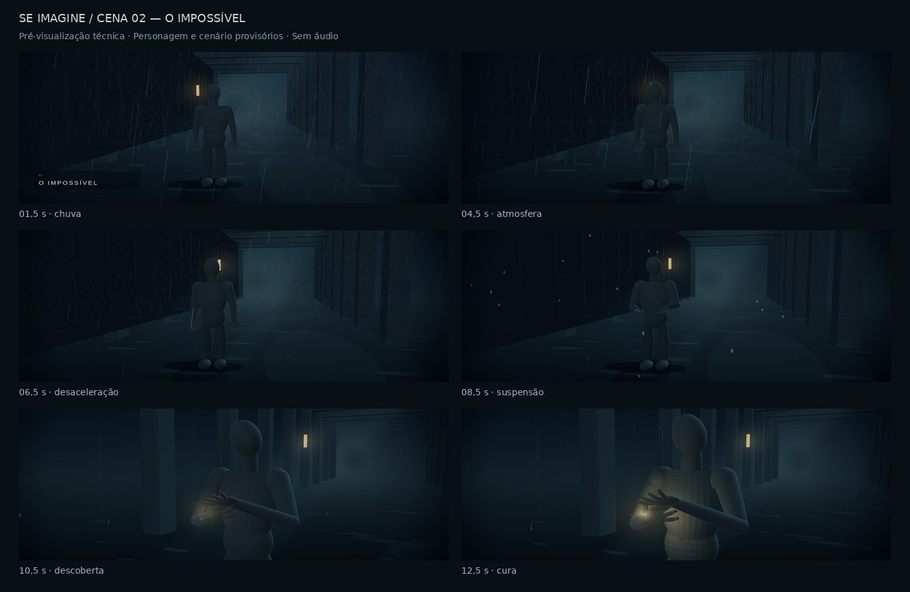

# SE IMAGINE — Cena 02: O impossível

Protótipo técnico animado de 15 segundos: **1920 × 1080, 30 FPS**, sem áudio.
Personagem, cenário, paleta e tipografia são provisórios e estão identificados no vídeo.

- [Abrir o MP4 Full HD](output/cena02-o-impossivel.mp4)
- [Baixar o MP4 Full HD](https://github.com/krunzo/Se-Imagine/raw/refs/heads/codex/cena02-animada-da143089/output/cena02-o-impossivel.mp4)
- [Baixar o pacote completo](output/cena02-entrega.zip)
- [Código-fonte e recursos](output/cena02-fonte/)
- [Técnicas, limitações e avaliação da automação das 26 cenas](output/RELATORIO.md)
- [Verificações da exportação](output/VERIFICACAO.json)

O protótipo mostra chuva intensa, desaceleração até suspensão, câmera com paralaxe,
respiração e gestos do manequim, luz localizada e início da cura.
Não foram alterados os áudios existentes do projeto nem usados serviços pagos.

Para a prévia interativa offline, baixe o pacote completo e abra `cena02-previa.html`
no navegador. O MP4 é a referência de reprodução com todos os 450 quadros.
